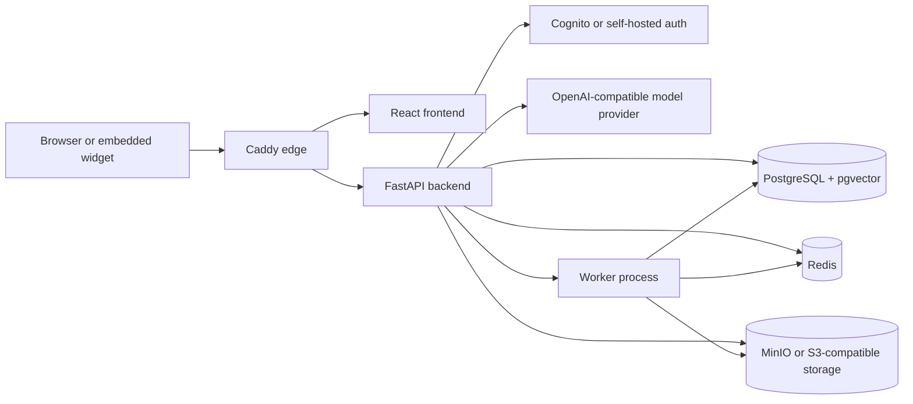

# OraOne

OraOne is a multitenant AI conversation platform for website agents. The current product supports knowledge-grounded chat, lead capture, workflows, integrations, billing primitives, an embeddable widget, and tenant-scoped administration.

This repository is the source of truth for the application and its local, self-hosted operational model. It is a release candidate, not a claim of live production readiness. See the [release checklist](docs/operations/RELEASE-CHECKLIST.md) for the gates that remain external to this checkout.

## Product scope

| Area | Current repository evidence |
| --- | --- |
| Website agents | Agent CRUD, deployment configuration, channels, branding, and public widget routes |
| AI conversations | Authenticated conversations, streaming, folders, sharing, suggestions, and public API access |
| Knowledge | Uploads, parsing, embeddings, pgvector retrieval, and RAG answer services |
| Operations | Redis-backed cache/rate limits, background workers, outbox delivery, audit logs, and health endpoints |
| Identity | Email-only Cognito mode or self-hosted local mode; backend validates Cognito access tokens |
| Authorization | PostgreSQL-backed platform roles plus tenant-scoped organization memberships |
| Storage | MinIO/S3-compatible object storage with a local-disk development fallback |
| Widget | `@oraone/widget` package and the `frontend/public/widget.js` loader |

Future product concepts are catalogued separately in [Product portfolio](docs/PRODUCT-PORTFOLIO.md) and are not represented as shipped functionality.

## Architecture at a glance



The production-like Compose stack exposes only Caddy on ports 80 and 443. Local development Compose publishes PostgreSQL on `127.0.0.1:5433`, Redis on `127.0.0.1:6379`, and MinIO on `127.0.0.1:9000`/`9001`.

Detailed diagrams and boundaries are in [architecture](docs/architecture/README.md).

## Repository layout

```text
backend/                         FastAPI app, database, services, migrations, tests
frontend/                        React app, E2E tests, public widget loader
frontend/packages/oraone-widget  Framework-neutral widget SDK source
docker-compose.dev.yml           Local PostgreSQL/pgvector, Redis, and MinIO
docker-compose.prod.yml          Production-like private stack plus Caddy
Caddyfile                        Edge routing and security headers
docs/                             Architecture, operations, security, and evidence
```

## Local quickstart

Prerequisites: Docker Engine with Compose v2, Python 3.11+, Node.js 20+, and Yarn 1.22.22. The supported path is documented in the [quickstart](docs/guides/QUICKSTART.md); the short version is:

```powershell
docker compose -f docker-compose.dev.yml up -d

cd backend
python -m venv .venv
.\\.venv\\Scripts\\Activate.ps1
python -m pip install -r requirements.txt
Copy-Item .env.example .env
alembic upgrade head
python -m uvicorn server:app --reload --port 8000
```

In a second terminal:

```powershell
cd frontend
yarn install --frozen-lockfile
$env:PORT = "3001"
yarn start
```

The API is available at `http://localhost:8000`, and the frontend at `http://localhost:3001` when port 3000 is occupied. Keep local credentials in ignored `.env` files; never copy production secrets into the repository.

Environment ownership and safe defaults are documented in [Environment configuration](docs/guides/ENVIRONMENT.md).

## Development checks

Backend checks run from `backend`:

```powershell
python -m compileall -q app server.py
python -m pytest -q
```

Frontend checks run from `frontend`:

```powershell
yarn build
npx eslint "src/**/*.{js,jsx}"
npx playwright test
```

The repository validation script also checks Compose, migrations, tests, and the production build:

```powershell
powershell -ExecutionPolicy Bypass -File backend/scripts/validate_local.ps1
```

For documentation and metadata checks, run:

```powershell
powershell -ExecutionPolicy Bypass -File scripts/validate_docs.ps1
```

See [Testing](docs/guides/TESTING.md) for prerequisites and evidence rules.

## Identity, authorization, and data

Production identity is intended to use the existing email-only Cognito pool. The backend validates issuer, signature, expiry, token use, client binding, and the Cognito subject before resolving the PostgreSQL user record. Self-hosted authentication remains useful for local development. Google, phone, and SMS authentication are intentionally outside the current identity contract.

Platform roles (`super_admin`, `admin`, `manager`, `user`) are separate from organization membership roles. PostgreSQL is authoritative; frontend checks are only presentation. Read [RBAC](docs/RBAC.md) and [authentication and authorization](docs/architecture/AUTHENTICATION-RBAC.md) before changing privileged behavior.

PostgreSQL is the system of record. Redis is a cache/rate-limit and distributed-idempotency dependency. MinIO is the local S3-compatible object store. If `S3_BUCKET` is unset, uploads use the configured local `UPLOAD_DIR`; the abstraction is intentionally retained so local development does not need an AWS bucket.

## Deployment posture

`docker-compose.prod.yml` is a production-like deployment artifact, not proof of a completed hosting deployment. It requires operator-supplied Cognito, database, storage, domain, and provider settings. Hostinger provisioning, DNS/TLS, production backups, live inbox authentication, paid provider lifecycles, and rollback drills remain external release gates.

Use the [deployment guide](docs/operations/DEPLOYMENT.md), [backup and restore guide](docs/operations/BACKUP-RESTORE.md), and [release checklist](docs/operations/RELEASE-CHECKLIST.md). Do not run a production migration against a guessed database URL.

## Security and support

Report vulnerabilities privately using the process in [SECURITY.md](SECURITY.md). Contribution expectations are in [CONTRIBUTING.md](CONTRIBUTING.md); support and issue triage guidance is in [SUPPORT.md](SUPPORT.md). Licensing is documented in [THIRD_PARTY_NOTICES.md](THIRD_PARTY_NOTICES.md) and [LICENSING-AUDIT.md](docs/LICENSING-AUDIT.md). No ownership or relicensing decision is implied by this documentation pass.

## Project status

The current branch contains repository and documentation improvements only; hosting is intentionally deferred. Local tests and builds are evidence of checkout health, not independent proof of production operation. See [CHANGELOG.md](CHANGELOG.md) for this branch's documentation changes and [ROADMAP.md](docs/ROADMAP.md) for clearly separated planned work.
