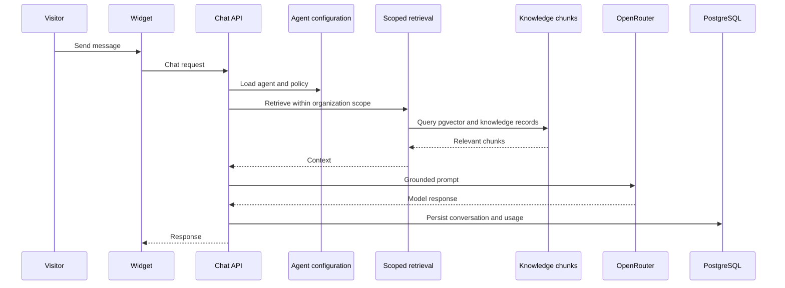
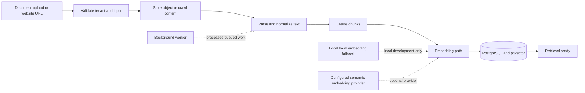

# AI and RAG

The knowledge path stores document metadata and embeddings in PostgreSQL and pgvector. Uploads use the storage abstraction, then backend services parse, chunk, embed, and retrieve context for answer generation.

The model interface is OpenAI-compatible and can target OpenRouter through server-side credentials. Provider selection, quotas, retries, and usage accounting live in backend services. A daily message quota exists; durable monetary/token spend ceilings remain open.

Production-like environments reject explicit mock inference. Credentialed provider smoke tests, cost reconciliation, prompt-injection review, and failure drills remain required.

## AI chat and RAG sequence

<!-- diagram: docs/diagrams/ai-chat-rag-sequence.mmd -->

## Knowledge ingestion flow

<!-- diagram: docs/diagrams/knowledge-ingestion.mmd -->

