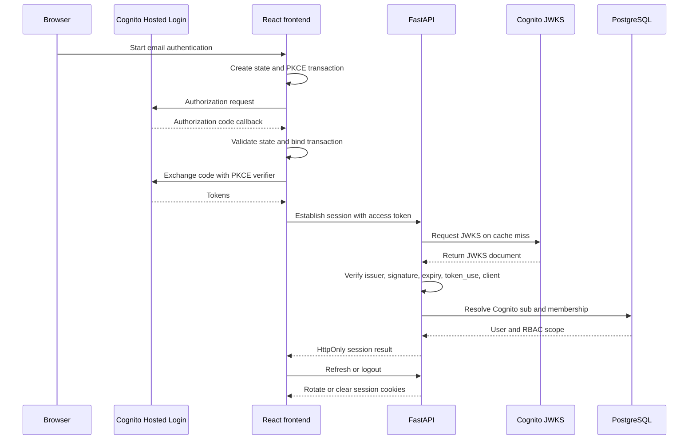
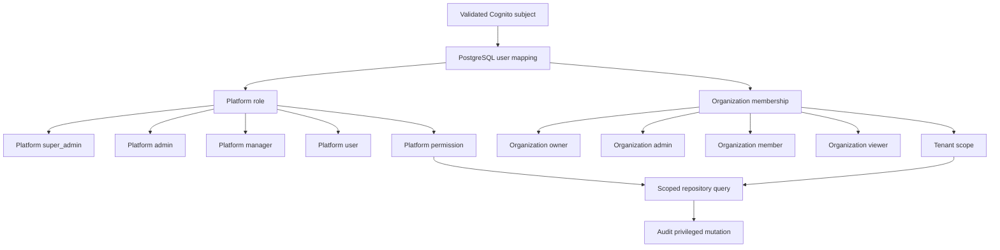

# Authentication and RBAC

Cognito mode uses the existing email-only user pool and authorization-code flow. The backend validates issuer, JWKS signature, expiry, token_use=access, and client binding, then maps the Cognito sub to the PostgreSQL user.

Self-hosted auth remains useful for local development. Google, phone, and SMS sign-in are not part of the current UI or identity contract.

PostgreSQL is authoritative for platform roles: super_admin, admin, manager, and user. Organization membership roles are tenant-scoped. Browser role fields and unvalidated claims cannot grant privileges. Privileged role changes are server-side and audit logged.

Protected request sequence: validate bearer token, resolve user by Cognito sub, reject disabled or missing users, resolve organization scope, apply endpoint permission, query scoped records, and audit privileged mutations.

See RBAC.md for bootstrap and migration procedures. Live Cognito and production database evidence are not present in this checkout.

## Cognito authentication sequence

<!-- diagram: docs/diagrams/cognito-auth-sequence.mmd -->

## Tenant and platform authorization

<!-- diagram: docs/diagrams/tenant-rbac.mmd -->

