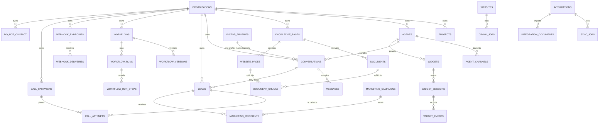

# Data model

The database is PostgreSQL 16 with the pgvector extension (`pgvector/pgvector:pg16`). The schema is
owned by Alembic. Every table is created by a migration in `backend/alembic/versions/`. Model
classes live in `backend/app/database/models/`.

Checked against the code at commit `e69494d`, with no uncommitted changes to models or migrations.

## Schema facts

| Item               | Value                                                                                                                                                                                                                 | Source                                                                      |
| ------------------ | --------------------------------------------------------------------------------------------------------------------------------------------------------------------------------------------------------------------- | --------------------------------------------------------------------------- |
| Alembic head       | `0061_feature_flag_overrides` (file `20261018_0061_feature_flag_overrides.py`). It is the only revision that no other revision names as its parent.                                                                   | `backend/alembic/versions/`                                                 |
| Migration files    | 63                                                                                                                                                                                                                    | `ls backend/alembic/versions`                                               |
| Merge points       | `0045_platform_roles` merges `0044_self_hosted_auth` and `0049_leads_conversation_idx`. `0061_feature_flag_overrides` merges `0060_admin_config_drafts` and `0060_error_events`.                                      | Revision headers                                                            |
| Tables             | 84 `__tablename__` declarations                                                                                                                                                                                       | `grep __tablename__ backend/app/database/models`                            |
| Migration runner   | `migrate` service runs `alembic upgrade head` before `backend` and `workers` start. The backend image also runs it at container start.                                                                                | `docker-compose.prod.yml`, `backend/Dockerfile`                             |
| Tenant key         | `organization_id` on almost every tenant table. `messages` has no `organization_id`. It is scoped through `conversations`.                                                                                            | Model foreign keys                                                          |
| Soft delete        | `SoftDeleteMixin` (`deleted_at`) on 17 model classes, including `Agent`, `Conversation`, `Document`, `Lead`, `Workflow`, `WebhookEndpoint`, `Widget` and `User`. Repository base queries filter `deleted_at IS NULL`. | `backend/app/database/base.py`, `repositories/base.py`                      |
| Embeddings         | `document_chunks.embedding` is `vector(1024)` with an HNSW index (`vector_cosine_ops`). The dimension follows `EMBED_DIM`, default 1024.                                                                              | `document_chunk.py`, migration `0005_rag_embeddings`                        |
| Encrypted columns  | Secret values are stored as Fernet ciphertext with a short display hint. Keys end in `_encrypted` and `_hint`.                                                                                                        | `services/channels/binding_secrets.py`, `core/crypto.py`                    |
| Row-level security | No migration creates a PostgreSQL policy. Tenant scoping is in application queries.                                                                                                                                   | `grep -i "create policy\|enable row level" backend/alembic` returns nothing |

## Table groups

The 84 tables fall into these groups. Names are the `__tablename__` values.

| Group                         | Tables                                                                                                                                                                                                                                    |
| ----------------------------- | ----------------------------------------------------------------------------------------------------------------------------------------------------------------------------------------------------------------------------------------- |
| Identity and tenancy          | `users`, `organizations`, `organization_members`, `organization_invitations`, `organization_entitlements`, `projects`, `teams`, `team_members`, `org_branding`, `ai_model_policies`                                                       |
| Billing and usage             | `plans`, `subscriptions`, `invoices`, `usage_counters`, `products`, `cost_reports`, `daily_metrics`                                                                                                                                       |
| API access                    | `api_keys`, `api_request_logs`                                                                                                                                                                                                            |
| Agents and channels           | `agents`, `agent_configs`, `agent_prompt_versions`, `agent_channels`, `channel_inbound_receipts`, `marketplace_installations`, `marketplace_reviews`                                                                                      |
| Website widget                | `widgets`, `widget_domains`, `widget_sessions`, `widget_events`                                                                                                                                                                           |
| Conversations and people      | `conversations`, `messages`, `conversation_folders`, `visitor_profiles`, `answer_feedback`, `leads`, `contact_submissions`, `newsletter_subscribers`                                                                                      |
| Knowledge and sources         | `knowledge_bases`, `knowledge_folders`, `documents`, `document_versions`, `document_chunks`, `websites`, `website_pages`, `crawl_jobs`, `crawl_frontier`, `crawl_logs`, `integrations`, `integration_documents`, `sync_jobs`, `sync_logs` |
| Outreach                      | `do_not_contact`, `call_campaigns`, `call_attempts`, `marketing_campaigns`, `marketing_recipients`                                                                                                                                        |
| Workflows                     | `workflows`, `workflow_versions`, `workflow_steps`, `workflow_runs`, `workflow_run_steps`                                                                                                                                                 |
| Webhooks                      | `webhook_endpoints`, `webhook_deliveries`, `webhook_outbox`                                                                                                                                                                               |
| Collaboration                 | `comments`, `mentions`, `reactions`, `tasks`, `notifications`, `activity_feed`, `resource_permissions`, `resource_follows`                                                                                                                |
| Administration and operations | `admin_config_drafts`, `admin_config_overrides`, `admin_config_publish_events`, `feature_flags`, `feature_flag_overrides`, `feature_requests`, `audit_logs`, `error_events`, `security_events`, `deployment_history`, `analytics_events`  |

## Key relationships

Foreign keys were read from the model files. `CASCADE` means the child row is deleted with its
parent. `SET NULL` means the reference is cleared.

| Child                                                                              | References                                                                   | Delete rule                                              |
| ---------------------------------------------------------------------------------- | ---------------------------------------------------------------------------- | -------------------------------------------------------- |
| `projects`, `agents`, `conversations`, `leads`, `widgets`, `documents`, `websites` | `organizations`                                                              | CASCADE                                                  |
| `agent_channels`                                                                   | `agents`                                                                     | CASCADE                                                  |
| `agent_configs`, `agent_prompt_versions`                                           | `agents`                                                                     | CASCADE                                                  |
| `channel_inbound_receipts`                                                         | `agents`, `organizations`                                                    | CASCADE                                                  |
| `messages`                                                                         | `conversations`                                                              | CASCADE                                                  |
| `conversations`                                                                    | `agents`, `visitor_profiles`, `conversation_folders`, `users`                | CASCADE for agent, SET NULL for visitor, folder and user |
| `leads`                                                                            | `conversations`, `agents`, `widgets`, `users`                                | SET NULL                                                 |
| `answer_feedback`                                                                  | `conversations`, `messages`                                                  | CASCADE                                                  |
| `widget_sessions`                                                                  | `widgets`, `conversations`                                                   | CASCADE, SET NULL                                        |
| `widget_events`                                                                    | `widgets`, `widget_sessions`                                                 | CASCADE                                                  |
| `widget_domains`                                                                   | `widgets`                                                                    | CASCADE                                                  |
| `documents`                                                                        | `knowledge_bases`, `integrations`, `knowledge_folders`, `projects`           | CASCADE, SET NULL for folder                             |
| `document_versions`                                                                | `documents`                                                                  | CASCADE                                                  |
| `document_chunks`                                                                  | `documents`, `website_pages`, `knowledge_bases`, `projects`, `organizations` | CASCADE                                                  |
| `website_pages`                                                                    | `websites`, `knowledge_bases`                                                | CASCADE                                                  |
| `crawl_jobs`, `crawl_frontier`, `crawl_logs`                                       | `websites`, `crawl_jobs`                                                     | CASCADE                                                  |
| `integrations`                                                                     | `knowledge_bases`                                                            | SET NULL                                                 |
| `integration_documents`                                                            | `integrations`, `documents`                                                  | CASCADE, SET NULL                                        |
| `sync_jobs`, `sync_logs`                                                           | `integrations`                                                               | CASCADE                                                  |
| `call_campaigns`                                                                   | `projects`, `users`                                                          | CASCADE, SET NULL                                        |
| `call_attempts`                                                                    | `call_campaigns`, `leads`                                                    | CASCADE                                                  |
| `marketing_recipients`                                                             | `marketing_campaigns`, `leads`                                               | CASCADE                                                  |
| `workflow_versions`, `workflow_steps`, `workflow_runs`                             | `workflows`                                                                  | CASCADE                                                  |
| `workflow_run_steps`                                                               | `workflow_runs`                                                              | CASCADE                                                  |
| `webhook_deliveries`                                                               | `webhook_endpoints`                                                          | CASCADE                                                  |
| `webhook_outbox`                                                                   | `organizations`                                                              | CASCADE                                                  |
| `organization_members`, `team_members`                                             | `organizations` or `teams`, `users`                                          | CASCADE                                                  |
| `subscriptions`                                                                    | `plans`                                                                      | no `ondelete` rule                                       |
| `invoices`                                                                         | `subscriptions`, `organizations`                                             | SET NULL, CASCADE                                        |

`error_events`, `audit_logs`, `security_events`, `contact_submissions`, `newsletter_subscribers`,
`plans`, `products`, `users`, `feature_flags`, `feature_flag_overrides` and the admin-config tables
have no foreign key to tenant tables. They are either platform-wide or intentionally unlinked.

## Data retention

Only rules that the code enforces are listed. Items marked "none found" have no automated
deletion in this repository.

| Data                                                                                          | Rule                                                                                                                     | Enforced by                                                                                                                         |
| --------------------------------------------------------------------------------------------- | ------------------------------------------------------------------------------------------------------------------------ | ----------------------------------------------------------------------------------------------------------------------------------- |
| `error_events` (5xx records and unhandled exceptions)                                         | Deleted when older than 30 days. Runs once a day in the `workers` process.                                               | `services/ops_service.py` (`ERROR_EVENT_RETENTION_DAYS = 30`, `prune_error_events`), `worker.py` (`PRUNE_INTERVAL_SECONDS = 86400`) |
| Error log viewer range                                                                        | A request may cover at most 30 days. Default window is 24 hours.                                                         | `services/error_events.py` (`MAX_RANGE_DAYS = 30`, `DEFAULT_RANGE_HOURS = 24`), `api/admin_logs/routes.py`                          |
| Error log downloads                                                                           | At most 10,000 rows per download. The response carries an `X-Row-Cap` header. Each download is written to the audit log. | `services/error_events.py` (`EXPORT_ROW_CAP = 10_000`), `api/admin_logs/routes.py`                                                  |
| Error record fields                                                                           | Messages are cut to 300 characters and stack traces to 4,000 characters. Records are scrubbed before storage.            | `services/error_events.py` (`MESSAGE_LIMIT`, `STACK_LIMIT`)                                                                         |
| Sign-in codes                                                                                 | 10-minute lifetime, held in the shared cache, not in a table                                                             | `services/auth_service.py` (`_LOGIN_CODE_TTL_SECONDS`)                                                                              |
| Soft-deleted rows                                                                             | Kept with `deleted_at` set. Hidden by repository queries. None found purged.                                             | `database/base.py`, `repositories/base.py`                                                                                          |
| `webhook_outbox`, `channel_inbound_receipts`, `api_request_logs`, `call_attempts`, `messages` | None found. These tables grow until an operator removes rows.                                                            | Searched `services/` for pruning and deletion                                                                                       |
| Uploaded files                                                                                | Stored on the `oraone_uploads` volume, not in the database. No cleanup job found.                                        | `docker-compose.prod.yml`, `services/storage.py`                                                                                    |

Some admin text in the platform console describes "automated retention windows configurable per
workspace" (`services/platform_intelligence.py`). No code in this repository implements that
setting, so this document does not rely on it.

## Backup and restore

The recovery procedure is in [BACKUP-RESTORE](../operations/BACKUP-RESTORE.md). This document does
not verify it. The backup and restore evidence is listed as a release gate in
[PRODUCT-PORTFOLIO](../PRODUCT-PORTFOLIO.md).
