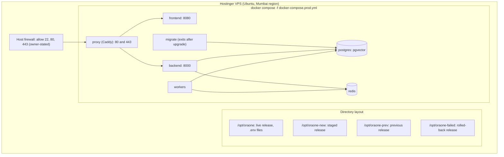
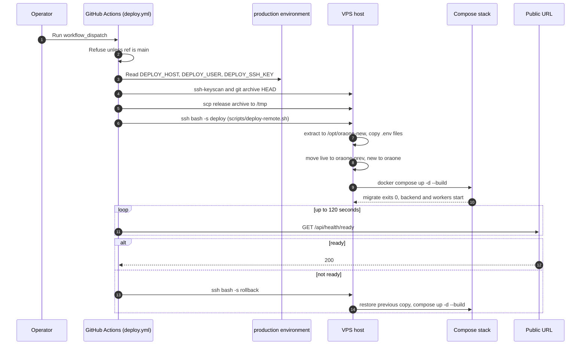
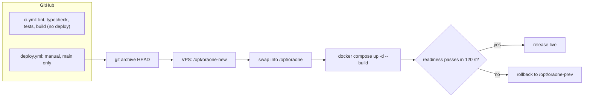

# Deployment diagram

How the production host is laid out, how names and certificates are set up, and how a release
reaches the server. The server's IP address is deliberately not written in this repository. Use
"the VPS IP" and keep the address in the DNS panel and the owner's records.

## How to read the source of each fact

- **Repo**: checked against a file in this repository. The file is named.
- **Owner**: stated by the owner in `docs/HOSTINGER-DEPLOYMENT.md` or `blocker.txt`. It is not in
  the repository and was not checked on the server or at the registrar.
- **Not verifiable here**: a setting that lives in GitHub, Hostinger or the registrar.

## 1. Host layout

| Item                  | Value                                                                                                                                                                                | Source                                                       |
| --------------------- | ------------------------------------------------------------------------------------------------------------------------------------------------------------------------------------ | ------------------------------------------------------------ |
| Host                  | Hostinger VPS, Mumbai region                                                                                                                                                         | Owner                                                        |
| Operating system      | Ubuntu 26.04                                                                                                                                                                         | Owner                                                        |
| Application directory | `/opt/oraone` (live copy, Compose runs here)                                                                                                                                         | Repo (`scripts/deploy-remote.sh`)                            |
| Staged release        | `/opt/oraone-new` (extracted from the uploaded archive)                                                                                                                              | Repo (`scripts/deploy-remote.sh`)                            |
| Previous release      | `/opt/oraone-prev` (kept for rollback)                                                                                                                                               | Repo (`scripts/deploy-remote.sh`)                            |
| Failed release        | `/opt/oraone-failed` (kept for inspection after rollback)                                                                                                                            | Repo (`scripts/deploy-remote.sh`)                            |
| Upload archive        | `/tmp/oraone-release.tar.gz`, deleted after extraction                                                                                                                               | Repo (`scripts/deploy-remote.sh`)                            |
| Secrets               | `/opt/oraone/.env` (Compose) and `/opt/oraone/backend/.env` (backend, workers, migrate). Copied into each new release with mode 600. The deploy refuses to run if either is missing. | Repo (`scripts/deploy-remote.sh`, `docker-compose.prod.yml`) |
| Container runtime     | Docker Compose, `docker-compose.prod.yml`                                                                                                                                            | Repo                                                         |
| Public ports          | 80 and 443 on the `proxy` container only                                                                                                                                             | Repo (`docker-compose.prod.yml`)                             |
| Internal ports        | `backend` 8000, `frontend` 8080, `postgres` 5432, `redis` 6379, reachable only on the Compose network                                                                                | Repo                                                         |



## 2. DNS records

These records are set in the DNS zone for the public domain. The registrar and DNS host are
owner-managed. Nothing in this repository sets them. The values below come from
`docs/HOSTINGER-DEPLOYMENT.md` (owner-stated) and must be checked with `dig` before any change.

| Name           | Type                       | Value                                                 | Purpose                                                                                                                                                                                                                                                    | Source                                                     |
| -------------- | -------------------------- | ----------------------------------------------------- | ---------------------------------------------------------------------------------------------------------------------------------------------------------------------------------------------------------------------------------------------------------- | ---------------------------------------------------------- |
| `@` (apex)     | A                          | the VPS IP                                            | Points the site at the server. Caddy needs 80 and 443 reachable to issue the certificate for `CADDY_DOMAIN`.                                                                                                                                               | Owner; the domain is required by `docker-compose.prod.yml` |
| `@`            | CAA                        | `0 issue "letsencrypt.org"` (proposed, not confirmed) | Limits which certificate authorities may issue. The `Caddyfile` names no issuer. The owner notes that Caddy may fall back to a second authority, which this CAA value would block. Confirm the authority and test a renewal before publishing this record. | Owner (proposal)                                           |
| `www`          | A or CNAME                 | Owner decision                                        | Not served. The `Caddyfile` answers only `CADDY_DOMAIN`, so `www` gets no certificate until the configuration adds it.                                                                                                                                     | Repo (`Caddyfile`), owner                                  |
| Mail           | MX, SPF (TXT), DKIM, DMARC | Copied from the Hostinger mail panel                  | Managed in Hostinger. Application mail is not connected yet. `SMTP_*` settings are not set on the server (owner).                                                                                                                                          | Owner; `blocker.txt` item 1                                |
| DNSSEC         | DS at the parent zone      | Enabled at the registrar (owner)                      | Signing is on at the registrar. A change to nameservers or keys must publish the DS record at the parent.                                                                                                                                                  | Owner                                                      |
| Registrar lock | Transfer lock              | Enabled (owner)                                       | Keep it on and keep registrar two-factor sign-in on.                                                                                                                                                                                                       | Owner                                                      |

Checks, from `docs/HOSTINGER-DEPLOYMENT.md` section 9. Run them from any machine:

```text
dig +short A <your domain>
dig +short CAA <your domain>
dig +short DNSKEY <your domain>     # DNSSEC: at least one DNSKEY is returned
```

Not verifiable here: the zone contents, the registrar lock, the DNSSEC state at the parent, and the
mail records. All are owner-managed.

## 3. Caddy and TLS

| Item             | Value                                                                                                                                                                                                                                                                                                                                                             | Source                                                   |
| ---------------- | ----------------------------------------------------------------------------------------------------------------------------------------------------------------------------------------------------------------------------------------------------------------------------------------------------------------------------------------------------------------- | -------------------------------------------------------- |
| Image            | `caddy:2.11.7-alpine`                                                                                                                                                                                                                                                                                                                                             | Repo (`docker-compose.prod.yml`)                         |
| Site address     | `{$CADDY_DOMAIN:localhost}`. Compose requires `CADDY_DOMAIN`, so production always sets it.                                                                                                                                                                                                                                                                       | Repo (`Caddyfile`, `docker-compose.prod.yml`)            |
| Certificates     | Automatic HTTPS, stored in the `oraone_caddy_data` volume. The site needs public DNS and reachable port 80 and 443 for issuance and renewal.                                                                                                                                                                                                                      | Repo (`Caddyfile`, volume list); Caddy default behaviour |
| Routing          | `/api/*` to `backend:8000`. Everything else to `frontend:8080`.                                                                                                                                                                                                                                                                                                   | Repo (`Caddyfile`)                                       |
| Compression      | `encode gzip zstd`                                                                                                                                                                                                                                                                                                                                                | Repo (`Caddyfile`)                                       |
| Response headers | HSTS (`max-age=63072000; includeSubDomains; preload`), `X-Content-Type-Options: nosniff`, `Referrer-Policy: strict-origin-when-cross-origin`, `X-Frame-Options: DENY`, `Cross-Origin-Opener-Policy: same-origin`, a Permissions-Policy that disables camera, microphone, geolocation, payment, USB, serial and Bluetooth, and a CSP with `frame-ancestors 'none'` | Repo (`Caddyfile`)                                       |
| Trusted proxy    | `TRUSTED_PROXY_IPS` names the Caddy container address. Only that peer's `X-Forwarded-For` is trusted for rate limiting.                                                                                                                                                                                                                                           | Repo (`docker-compose.prod.yml`)                         |

## 4. Firewall, SSH and host hardening

Repository files do not configure the host firewall, fail2ban or SSH. Every row below is
owner-stated.

| Control                 | Required state                                                                                                                                                                                                                     | Source                                             |
| ----------------------- | ---------------------------------------------------------------------------------------------------------------------------------------------------------------------------------------------------------------------------------- | -------------------------------------------------- |
| Inbound firewall        | Allow 22/tcp, 80/tcp and 443/tcp. Deny the rest.                                                                                                                                                                                   | Owner                                              |
| Docker and the firewall | Docker publishes container ports through its own rules, which can bypass host firewall rules. This repository publishes only 80 and 443 on `proxy`. After any change, check `docker ps` and confirm nothing else listens publicly. | Repo (`docker-compose.prod.yml`), Docker behaviour |
| fail2ban                | Enabled, with the `sshd` jail active                                                                                                                                                                                               | Owner                                              |
| SSH                     | Key-only login. Password login and root password login disabled.                                                                                                                                                                   | Owner                                              |
| Deploy user             | A dedicated user in the `docker` group. `blocker.txt` item 5 proposes `root`. The owner decision is the dedicated user.                                                                                                            | Repo (`blocker.txt`), owner                        |
| Security updates        | Not stated in any file                                                                                                                                                                                                             | Not configured (unknown)                           |

## 5. Release path from GitHub

The deploy is manual. Only the `deploy.yml` workflow can ship, and only from `main`.

| Step              | What happens                                                                                                                                                                                                                                                                                                   | Source                                                  |
| ----------------- | -------------------------------------------------------------------------------------------------------------------------------------------------------------------------------------------------------------------------------------------------------------------------------------------------------------- | ------------------------------------------------------- |
| 1. Trigger        | An operator runs **Deploy production** from the Actions tab (`workflow_dispatch`).                                                                                                                                                                                                                             | Repo (`.github/workflows/deploy.yml`)                   |
| 2. Gate           | The job runs only for `refs/heads/main`, and uses the `production` environment. Approval rules on that environment are set in GitHub settings.                                                                                                                                                                 | Repo (`deploy.yml`); approval rules not verifiable here |
| 3. Secrets        | Environment secrets `DEPLOY_HOST`, `DEPLOY_USER`, `DEPLOY_SSH_KEY`. The job checks they exist and never echoes them.                                                                                                                                                                                           | Repo (`deploy.yml`)                                     |
| 4. Host key       | `ssh-keyscan` records the host key on that run. The workflow notes that this trusts whatever key the host presents at that moment.                                                                                                                                                                             | Repo (`deploy.yml`)                                     |
| 5. Archive        | `git archive HEAD` to a tar.gz on the runner. The archive is the committed tree, not the working copy.                                                                                                                                                                                                         | Repo (`deploy.yml`)                                     |
| 6. Upload         | `scp` to `/tmp/oraone-release.tar.gz` on the host, with `StrictHostKeyChecking=yes`.                                                                                                                                                                                                                           | Repo (`deploy.yml`)                                     |
| 7. Swap and start | `ssh ... bash -s -- deploy < scripts/deploy-remote.sh`. The script extracts to `/opt/oraone-new`, copies both `.env` files with mode 600, moves the live copy to `/opt/oraone-prev`, moves the new copy to `/opt/oraone`, then runs `docker compose --env-file .env -f docker-compose.prod.yml up -d --build`. | Repo (`deploy.yml`, `scripts/deploy-remote.sh`)         |
| 8. Readiness      | The runner polls `https://oraone.in/api/health/ready` for up to 120 seconds, 5 seconds between tries. The health endpoint is `backend/app/api/health.py`.                                                                                                                                                      | Repo (`deploy.yml`, `health.py`)                        |
| 9. Rollback       | If readiness fails, the runner runs `deploy-remote.sh rollback`. The live copy moves to `/opt/oraone-failed`, the previous copy moves back to `/opt/oraone`, and Compose rebuilds it. If a step fails after the swap, the script's error trap does the same.                                                   | Repo (`deploy.yml`, `scripts/deploy-remote.sh`)         |
| 10. Cleanup       | The runner deletes its key file, even on failure.                                                                                                                                                                                                                                                              | Repo (`deploy.yml`)                                     |

CI (`.github/workflows/ci.yml`) runs on pull requests and pushes to `main`. It lints, type-checks,
tests and builds the web app, and tests the backend. It never deploys.





## 6. Items that differ from other docs

- `docs/HOSTINGER-DEPLOYMENT.md` section 1 says the deploy workflow is "not present in the
  repository" and that the release is built on the server from a checked-out commit. Both are out
  of date. `deploy.yml` and `scripts/deploy-remote.sh` are committed (commit `e69494d`), and the
  current release is built from a git archive of `HEAD`. That document has not been changed here.
- `docker-compose.prod.yml` says to run with `--env-file .env.production`. `deploy-remote.sh` passes
  `--env-file .env`. Use the second form for the live copy, and make sure the file exists.
- The owner notes that SMTP is not configured on the server (`blocker.txt` item 1), and that backups
  are not configured (`docs/HOSTINGER-DEPLOYMENT.md` section 1). Sign-in codes depend on SMTP.
  Without it, the codes are not delivered.

## 7. Not verified in this review

- Nothing on the live host was checked: no `dig`, no `docker ps`, no firewall or fail2ban state.
- The GitHub `production` environment rules and secrets were not inspected.
- The Hostinger, registrar and DNS panels were not inspected.
- Certificate issuance and renewal were not tested.
