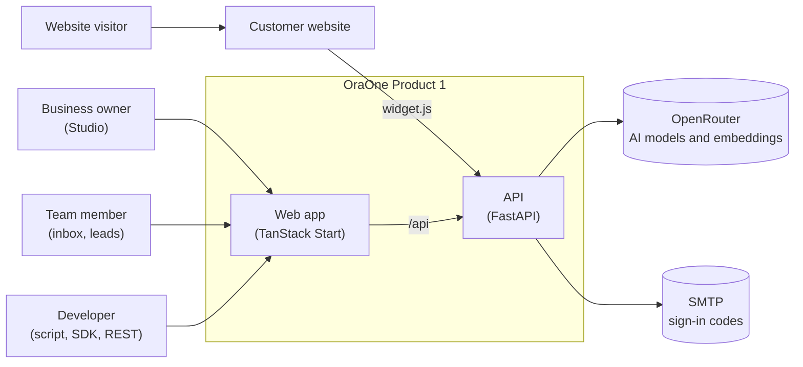
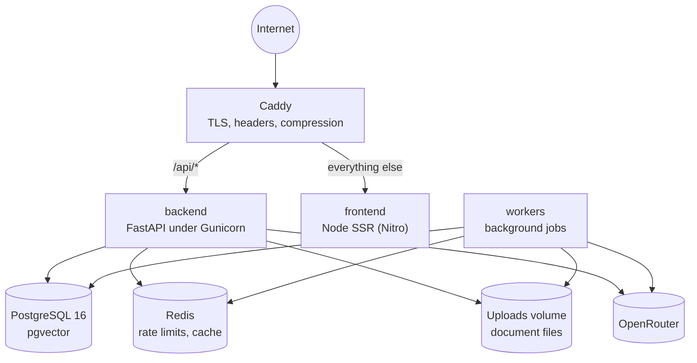
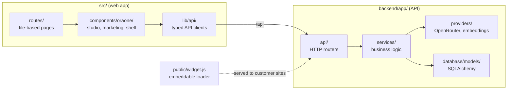
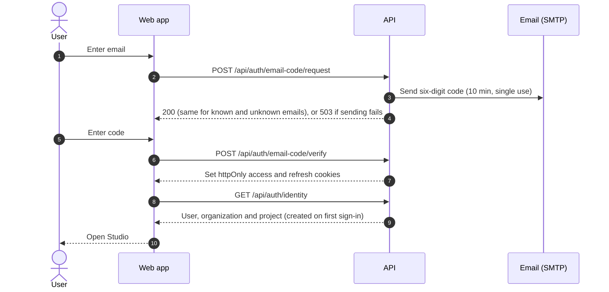
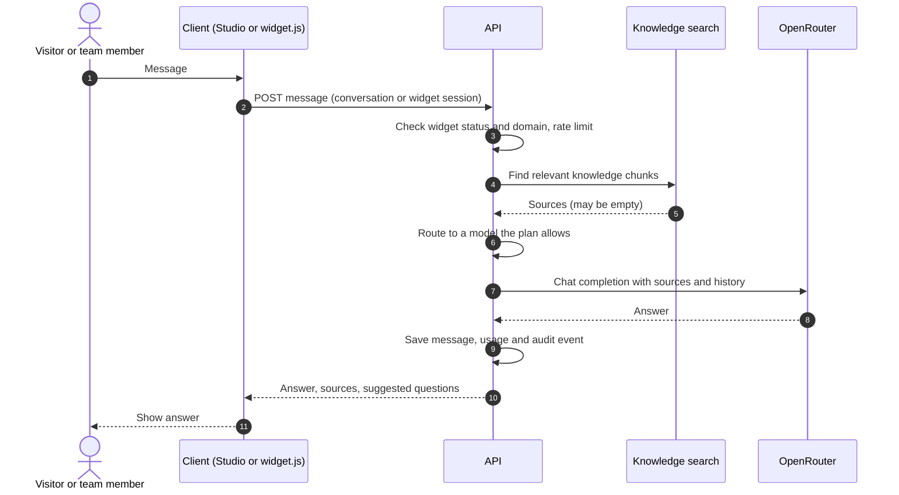
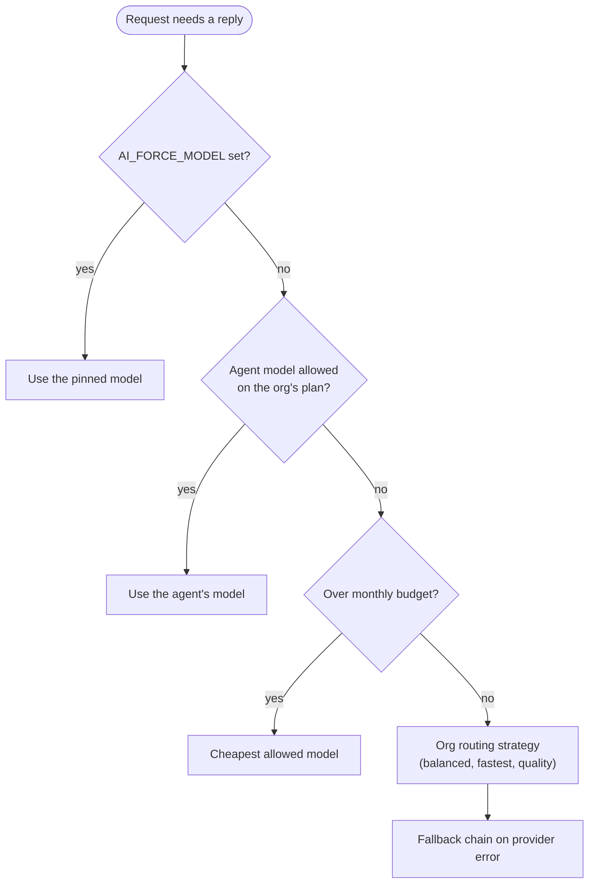
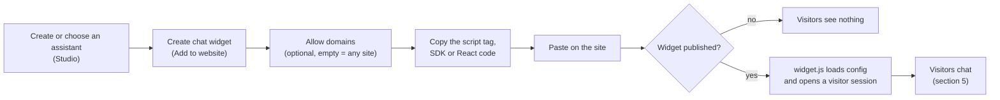
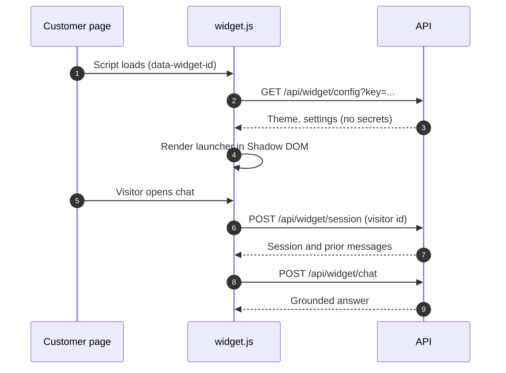
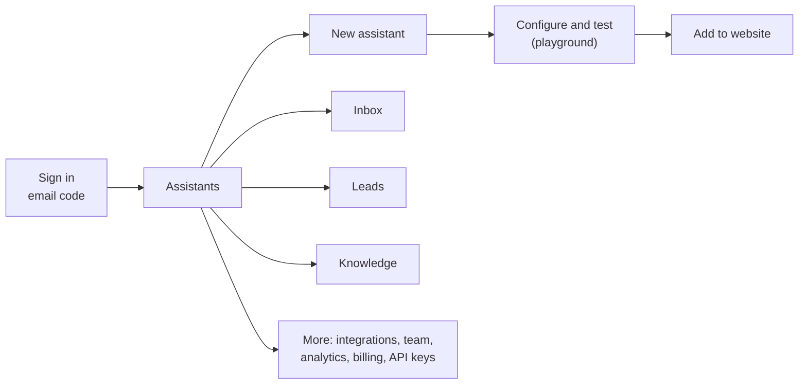

# Architecture and flow diagrams

These diagrams use Mermaid and render on GitHub. They describe Product 1 as it is
built in this repository.

## 1. System context

Who uses OraOne and which outside services it depends on.

## 2. Containers

How the parts run in production. Caddy is the only public entry point.

## 3. Repository layout

## 4. Sign-in (passwordless email code)

## 5. Assistant reply (Studio playground and website widget)

## 6. Model selection

## 7. Website widget: install and go live

## 8. Widget loader at runtime

## 9. Studio journey for a new owner

## 10. Lazy loading

Studio screens and the public and workspace page routes load their code when the
route is entered. Each shows a `RouteLoader` while it loads, and the router shows
`NavigationProgress` during navigations. Heavy charts load only where they are used.
