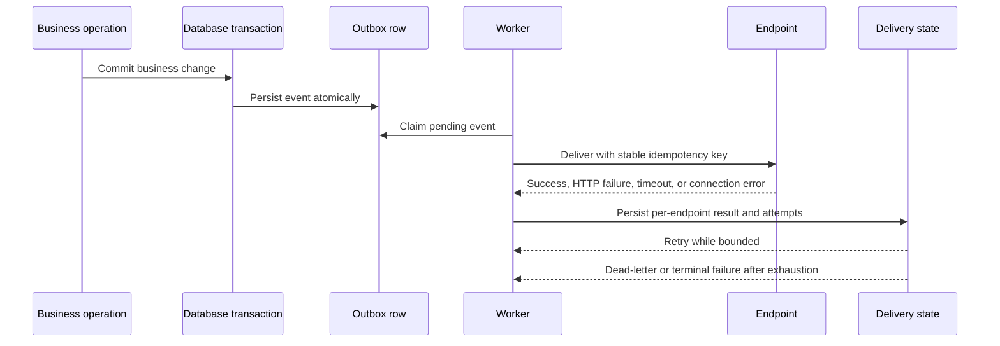

# Events and workers

Business events needing asynchronous delivery are persisted into an outbox. The worker claims pending work, delivers webhook endpoints with bounded retries, records per-endpoint results, and applies terminal handling for exhausted attempts.

Webhook destinations are validated at create/update time and revalidated before delivery. Redirects are disabled. Deployment egress controls remain defense in depth.

The worker is separate from the API container in the production-like Compose file. Do not hold a database transaction open while waiting on remote HTTP. Required evidence includes connection failures, HTTP 5xx, timeout, partial fan-out, restart, and duplicate-delivery behavior.

## Webhook outbox sequence

<!-- diagram: docs/diagrams/webhook-outbox.mmd -->

