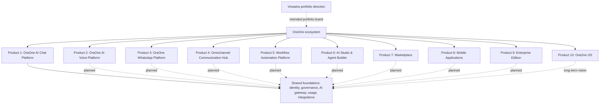

# Architecture

- [System overview](SYSTEM-OVERVIEW.md)
- [Authentication and RBAC](AUTHENTICATION-RBAC.md)
- [AI and RAG](AI-RAG.md)
- [Events and workers](EVENTS-WORKERS.md)
- [Environment and storage](../guides/ENVIRONMENT.md)

Mermaid sources are in ../diagrams. The local validator checks source-to-embed parity, and this branch's ten sources were parsed with Mermaid 11.12.0 in an isolated temporary validation environment. GitHub rendering is presentation evidence, not runtime evidence.

## OraOne ecosystem context

<!-- diagram: docs/diagrams/system-context.mmd -->

