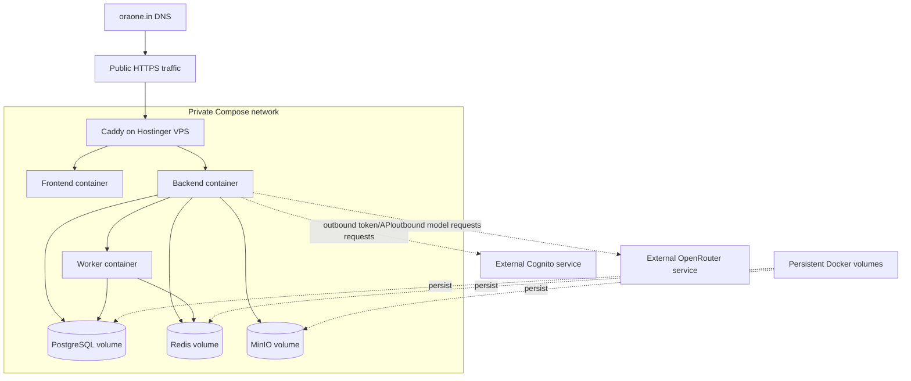
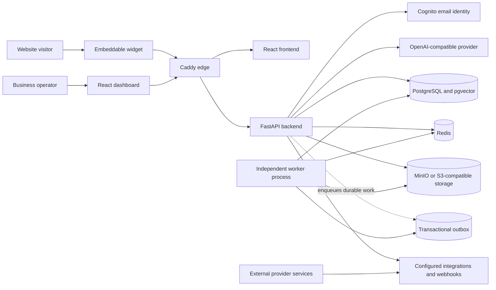

# System overview

Caddy is the edge entry point in the production-like Compose file. It routes /api/* to FastAPI and all other paths to the frontend. The backend owns authentication, authorization, tenant resolution, persistence, provider calls, uploads, and public API limits.

PostgreSQL with pgvector is the system of record. Redis provides cache, rate limits, distributed idempotency, and coordination where configured. MinIO or another S3-compatible service stores documents and branding assets. Local disk is the development fallback.

The development Compose file publishes local stateful ports. The production-like file keeps backend, worker, PostgreSQL, Redis, and MinIO private and publishes only Caddy.

Provider failures must remain visible and must not become a production claim through a local fallback. Outbox work is persisted before delivery; external delivery and recovery drills remain release gates.

## Deployment topology

<!-- diagram: docs/diagrams/deployment.mmd -->

## Product 1 system architecture

<!-- diagram: docs/diagrams/product1-system-architecture.mmd -->

