# System architecture

This page describes how the production stack is built and how requests, channel messages,
AI answers, outbound contact, workflows and admin changes move through it. Every component
name below was checked against `docker-compose.prod.yml`, `Caddyfile`, `backend/server.py`,
`backend/worker.py`, and the backend modules named in each section.

**Evidence basis.** Code at commit `e69494d` (branch `feat/product1-launch`), plus the uncommitted working-tree
changes that were present when this page was written (noted where they matter). Nothing here
was run against a live server. Provider behaviour (Meta, Twilio, ElevenLabs, OpenRouter, SMTP,
OAuth providers) is described from the code's calls, not from provider tests. The DNS, firewall
and host settings are in [DEPLOYMENT-DIAGRAM](DEPLOYMENT-DIAGRAM.md). The tables are in
[DATA](DATA.md).

## 1. Containers

Production runs as one Docker Compose project (`docker-compose.prod.yml`). Only `proxy` publishes
ports (80 and 443). Everything else is on the internal Compose network.

| Compose service | Image or build                                                                       | Role                                                                                                                        | Depends on                     |
| --------------- | ------------------------------------------------------------------------------------ | --------------------------------------------------------------------------------------------------------------------------- | ------------------------------ |
| `proxy`         | `caddy:2.11.7-alpine`, mounts `Caddyfile`                                            | TLS (automatic, Let's Encrypt), gzip and zstd, security headers, routes `/api/*` to backend and everything else to frontend | `backend`, `frontend`          |
| `frontend`      | `frontend.Dockerfile` (Bun build, then `node .output/server/index.mjs` on port 8080) | TanStack Start web app, server-rendered, plus `public/widget.js`                                                            | `backend`                      |
| `backend`       | `backend/Dockerfile` (Python 3.12, Gunicorn with Uvicorn workers, port 8000)         | FastAPI API: auth, tenants, channels, RAG, workflows API, admin                                                             | `migrate`, `postgres`, `redis` |
| `workers`       | same image as `backend`, command `python worker.py`                                  | Workflow scheduler, wait resumption, webhook outbox delivery, daily error-event pruning                                     | `migrate`, `postgres`, `redis` |
| `migrate`       | same image, command `alembic upgrade head`, runs once                                | Schema migration; exits 0 before `backend` and `workers` start                                                              | `postgres`                     |
| `postgres`      | `pgvector/pgvector:pg16`                                                             | System of record, pgvector for embeddings                                                                                   | none                           |
| `redis`         | `redis:7.4.11-alpine`                                                                | Rate limits, idempotency, shared short-lived cache, entitlements cache                                                      | none                           |

Named volumes: `oraone_postgres_data`, `oraone_redis_data`, `oraone_uploads` (shared by `backend`
and `workers` at `/var/lib/oraone/uploads`), `oraone_caddy_data`.

Notes verified in code:

- The backend image's `CMD` also runs `alembic upgrade head` before Gunicorn starts. The
  `migrate` service runs it first, so the second run is normally a no-op.
- `workers` sets `RUN_BACKGROUND_WORKERS=true`. `backend` sets it to `false`, so the API process
  does not start the background loops (`backend/server.py`, lifespan).
- `workers` has no HTTP port and its health check is disabled, so Compose supervises the process.

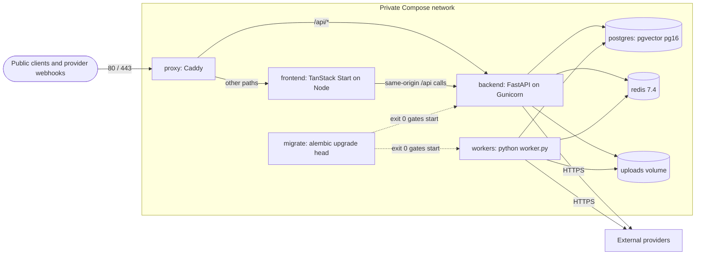

## 2. Request flow

A browser or API client reaches the app through Caddy. Caddy adds the edge headers and routes
the request. The backend stamps the tenant on the database session after it authenticates the
caller.

Verified in: `Caddyfile`, `backend/app/middleware/` (request context, JWT auth, org context,
rate limit, idempotency, upload size limit), `backend/app/middleware/org_context.py`
(`apply_rls_on_session`).

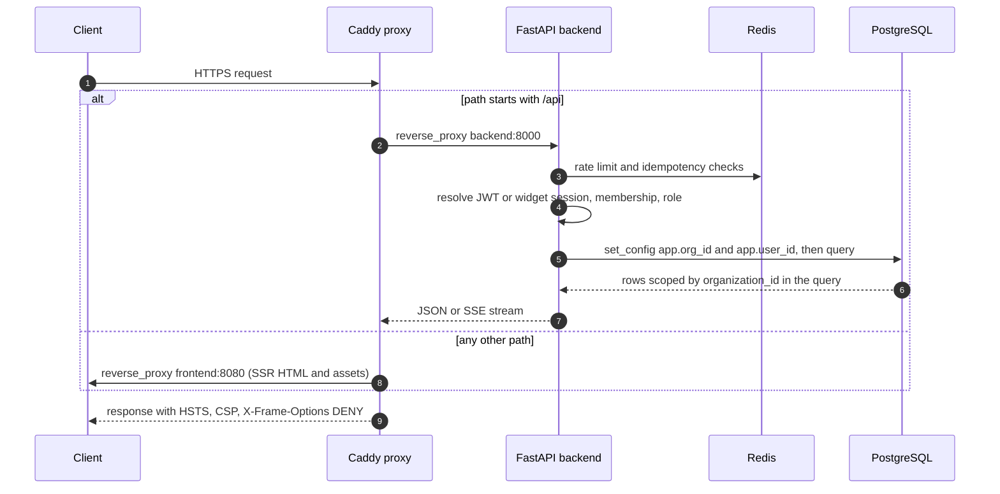

Tenant isolation is enforced in application code: queries filter on `organization_id`.
`set_config('app.org_id', ...)` is also applied to the transaction, but no PostgreSQL row-level
security policy is created by any migration in this repository. The code itself records this
(`backend/app/services/platform_intelligence.py`, dimension "Database engine RLS": "PostgreSQL
RLS remains a separate deployment gate until policies are installed and verified"). See
section 9.

## 3. Channel flow

Every messaging and voice surface funnels into one pipeline. The channel adapter normalises
the provider payload. The binding lookup finds the agent. Then the same inbound pipeline
runs. The web widget and the authenticated in-app chat use the same retrieval, but call it
through different functions (section 4).

Verified in: `backend/app/api/omnichannel/routes.py`, `backend/app/services/channels/adapters.py`,
`backend/app/services/omnichannel_service.py` (`handle_inbound`), `backend/app/api/voice/routes.py`,
`backend/app/api/widgets/public.py`.

| Surface                             | Inbound route                                                        | Authentication (fails closed unless noted)                                                                                        | Binding lookup                                                | Reply path                                                                                                            |
| ----------------------------------- | -------------------------------------------------------------------- | --------------------------------------------------------------------------------------------------------------------------------- | ------------------------------------------------------------- | --------------------------------------------------------------------------------------------------------------------- |
| WhatsApp via Twilio, SMS via Twilio | `POST /api/channels/twilio/inbound`                                  | Twilio `X-Twilio-Signature` over public URL and form                                                                              | `agent_channels.phone_number` equals the `To` number, enabled | Twilio Messages REST call; webhook returns empty TwiML                                                                |
| WhatsApp via Meta Cloud API         | `GET` (handshake) and `POST /api/channels/meta/inbound`              | `X-Hub-Signature-256` with the Meta app secret, checked before parsing                                                            | `configuration.phone_number_id`                               | Graph API `/{phone_number_id}/messages`                                                                               |
| Instagram direct messages           | `GET` and `POST /api/channels/meta_instagram/inbound`                | Same Meta signature                                                                                                               | `configuration.instagram_account_id`                          | Graph API `me/messages`                                                                                               |
| Telegram                            | `POST /api/channels/telegram/{token}/inbound`                        | `X-Telegram-Bot-Api-Secret-Token` compared with the binding secret                                                                | `configuration.bot_token`                                     | Bot API `sendMessage`                                                                                                 |
| Email (inbound only)                | `POST /api/channels/email/inbound`                                   | `x-email-inbound-secret` header, deployment-wide secret                                                                           | `configuration.inbound_address`                               | None sent by the app ("delivery via provider")                                                                        |
| Mobile and desktop SDK              | `POST /api/channels/sdk/inbound`                                     | `X-OraOne-Signature` HMAC-SHA256 with the binding `sdk_secret`                                                                    | `agent_id` from the request                                   | Synchronous JSON reply in the HTTP response                                                                           |
| AI voice (Twilio Voice)             | `POST /api/voice/inbound`, then `POST /api/voice/gather`             | Twilio signature on each turn                                                                                                     | `agent_channels.phone_number` (voice, then phone channels)    | TwiML `Say` or `Play` (ElevenLabs audio when configured), `Gather` again; `Dial` to `VOICE_HANDOFF_NUMBER` on handoff |
| Website chat widget                 | `POST /api/widget/session`, `/chat`, `/stream`, `/lead`, `/escalate` | Widget public key, published status, optional domain allow-list (browser check only), per-visitor session token stored as SHA-256 | Widget row and its agent                                      | JSON, or SSE on `/stream`                                                                                             |

Common rules:

- A provider redelivery is ignored. `_claim_provider_message` records the provider message id in
  `channel_inbound_receipts` (migration `0057`), so a duplicate gets no second reply.
- Paused agents do not run the model. The pipeline returns a fixed "unavailable" reply.
- A message that is only whitespace is not answered.
- Binding lookups only match enabled bindings. The WhatsApp phone number ID, Instagram account ID,
  email inbound address and voice phone number are claimed per organisation when saved
  (`services/channels_service.py`, `_assert_identifier_not_claimed`), so one organisation cannot take
  another's identifier.

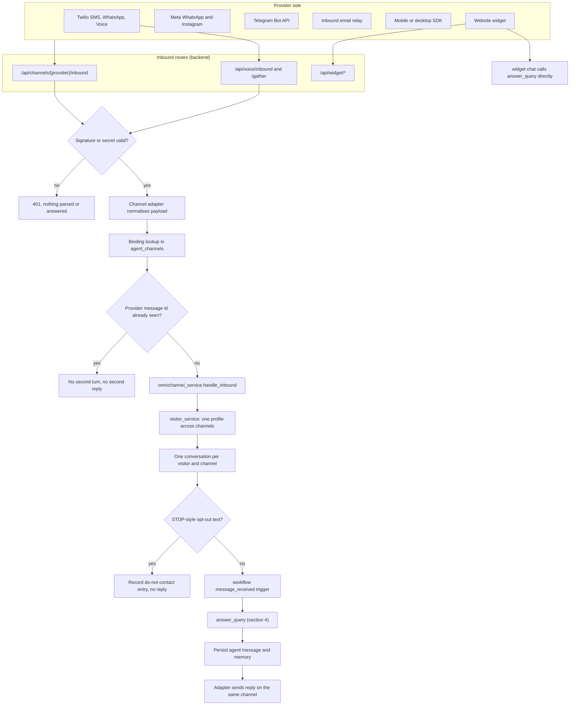

Sequence for an inbound WhatsApp or SMS message through Twilio:

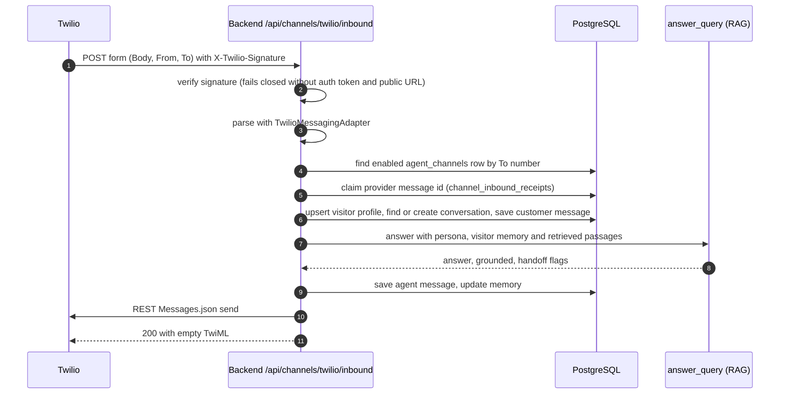

## 4. AI flow

There are two answer paths. Both use the same retrieval code (`rag_service.hybrid_search`). The
grounded answer path has the scope guard in front of it.

| Path                            | Entry                                                     | Function                                                            | Scope guard                   | Used by                                                                           |
| ------------------------------- | --------------------------------------------------------- | ------------------------------------------------------------------- | ----------------------------- | --------------------------------------------------------------------------------- |
| Grounded answer                 | `answer_query` in `backend/app/services/rag_answer.py`    | Scope check, retrieval, generation or extractive fallback           | Yes (working tree, see below) | Widget chat, omnichannel (all messaging channels), `/api/rag/query`, public API   |
| In-app assistant and agent runs | `AgentRuntime` in `backend/app/services/agent_runtime.py` | Prompt assembly, `search_chunks`, `provider.chat`, token accounting | Not in this path              | Authenticated conversations under `/api/conversations`, workflow `agent_run` step |

Scope guard (`backend/app/services/business_scope_guard.py`). This file and the
`assistant_profiles.py` service are **uncommitted** in the working tree at the time of writing,
and `answer_query` is also modified. The behaviour below is what those files do now:

1. Small talk (greeting, thanks, goodbye) gets a fixed reply. No retrieval, no model call.
2. A strong out-of-scope pattern (for example poems, jokes, politics, diagnosis) gets a fixed
   refusal. No retrieval, no model call.
3. Business vocabulary (price, hours, booking, refund and similar) is in scope.
4. Weak out-of-scope topics (capital cities, weather, crypto, coding) are refused.
5. Anything else is ambiguous. Retrieval runs first. If there is no passage, the answer is a
   fixed handoff. If there are passages, one fixed-label model call (`IN_SCOPE` or
   `OUT_OF_SCOPE`, max 5 tokens, temperature 0) decides whether to refuse.

Grounding and generation:

- Retrieval (`rag_service.hybrid_search`): pgvector cosine distance on `document_chunks.embedding`
  (HNSW index) plus PostgreSQL full-text search, merged with reciprocal rank fusion (`RRF_K = 60`),
  then reranked. The default reranker is `heuristic`. The `cohere`, `jina` and `local` rerankers
  are optional.
- Embeddings: OpenRouter when `OPENROUTER_API_KEY` is set. Without it, a local hashing embedder
  is used (dimension 1024).
- Context: up to 6,000 characters of passages, numbered for inline citations.
- System prompt: "Answer using ONLY the numbered CONTEXT passages", ask one clarifying question
  when the request is ambiguous, and never invent facts. The assistant's own instructions come
  after this, and visitor memory is marked as untrusted data inside delimiters.
- Model call: `get_provider().chat(...)`, which is the OpenRouter provider and fails without
  `OPENROUTER_API_KEY`. `AI_FORCE_MODEL` overrides the model.
- Degradation: no passages gives the handoff; provider error or empty output gives an extractive
  answer built from the top three passages, with `grounded = false` and `generated = false`.
- Handoff: when `handoff` is true, `lead_service.upsert_conversation_lead` records a lead note with
  the question, so the team can follow up. This is the only automatic escalation. A visitor who
  asks for a person uses `/api/widget/escalate`, which marks the widget session as escalated and
  records a widget event.

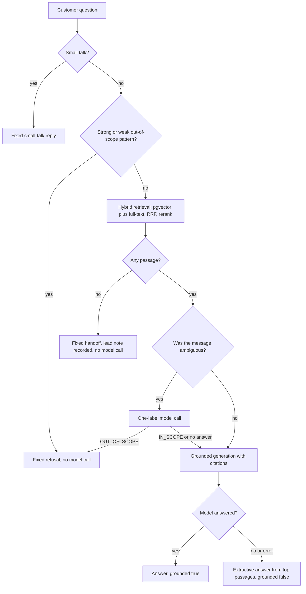

Sequence for a widget question that needs a human:

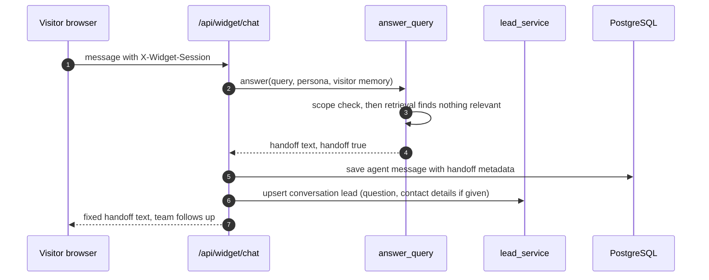

## 5. Outbound flow

Outbound contact has three entry points: call campaigns, marketing campaigns and workflow
`send_message` steps. All three call the same pure decision function,
`outreach_policy.check_outbound`. Calls also apply the lead-level checks in
`campaign_service.evaluate_lead`.

Rules, in the order `check_outbound` applies them (`backend/app/services/outreach_policy.py`):

1. The contact is on the organisation's do-not-contact list: refused.
2. The contact opted out (STOP reply or flag): refused.
3. Consent is withdrawn: refused.
4. Consent is not `given`: refused, unless `is_reply=True` and the contact wrote in the last 24
   hours. **No caller in the code passes `is_reply=True`**, so the 24-hour reply exception is
   not used by any path.
5. Quiet hours: 21:00 to 08:00 in the contact's local time (their own timezone, or the
   organisation timezone when the country code is recognised). Not waived by a reply.
6. Attempt cap: at most 2 outbound attempts in a rolling 24 hours (default). Not waived by a reply.

Call campaigns (`backend/app/services/calls/campaign_service.py`, routes in
`backend/app/api/calls/routes.py`):

- Planning (`plan_attempts`) records a `skipped` attempt with the reason for every blocked lead.
  At most 1,000 leads per campaign (`MAX_CAMPAIGN_LEADS`).
- `dial_next` locks the campaign row, so a campaign has at most one call in progress. It commits
  the claimed attempt before calling Twilio.
- `place_call` posts to Twilio `Calls.json` with `Url` set to `/api/voice/twiml?attempt=...` and
  `StatusCallback` set to `/api/voice/status`. Phone numbers must be E.164.
- `Start` dials the first call. When Twilio reports a finished call on `/api/voice/status`, the
  next call is dialled. A call still `calling` after 30 minutes is checked with Twilio before it
  is released.
- Status callbacks verify `X-Twilio-Signature` and fail closed.

Marketing campaigns (`backend/app/services/marketing/campaigns.py`): consent and suppression are
checked at planning time with `is_reply=False`. Email messages carry a signed unsubscribe link.
Sending runs inside the request. No email sender is registered for campaigns in this code.

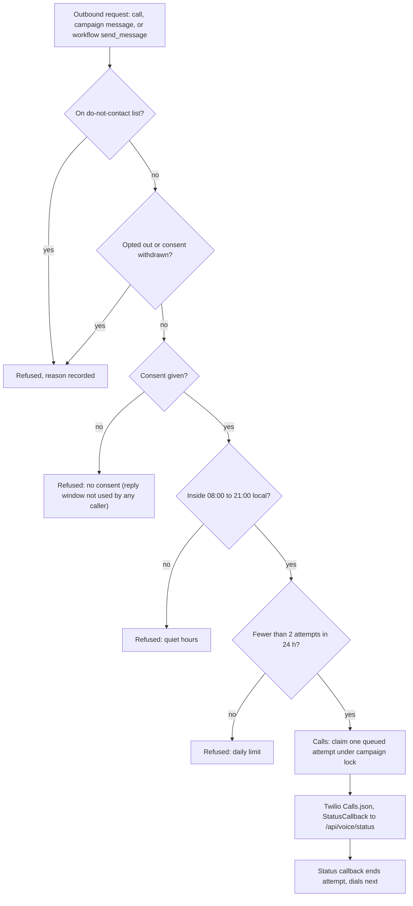

Sequence for one call in a campaign:

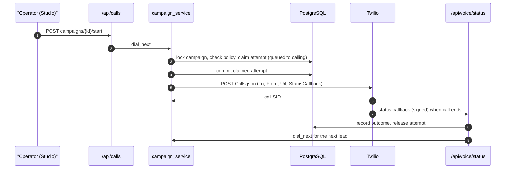

## 6. Workflow flow

Workflows are stored as a definition with steps, versions and runs
(`backend/app/services/workflow_engine.py`, `workflow_triggers.py`, `workflow_scheduler.py`,
`workflow_senders.py`, `backend/app/database/models/workflow.py`).

Triggers (`WorkflowTrigger`): `manual`, `schedule` (interval minutes in `trigger_config`), `event`
(for example `lead_created` from `lead_service` and `lead_import_service`, and `message_received`
from `omnichannel_service`), and `integration` (the enum exists, but no code fires it).

Step types (from the engine docstring and `WorkflowStepType`): `ai_prompt`, `ai_classify`,
`ai_extract`, `ai_summarize`, `ai_sentiment`, `ai_translate`, `kb_query`, `agent_run`,
`transform`, `condition`, `approval`, `notification`, `delay`, `send_message`, `create_task`,
`webhook`. Each step can set `retry` and `continue_on_error`.

Run states: `queued`, `running`, `awaiting_approval`, `completed`, `failed`, `cancelled`.

Execution rules:

- The scheduler runs every 60 seconds, starts due schedule runs, and dispatches event runs
  (`workflow_scheduler._POLL_SECONDS = 60`). The `workers` process runs it.
- `delay` steps are durable: the step is persisted and `resume_due_waits` resumes it. The engine
  never sleeps in a request.
- `approval` pauses the run in `awaiting_approval`. `resume_run` continues or stops it from the API.
- `send_message` checks consent through `check_outbound` (section 5), then uses the enabled
  channel binding. An unconfigured channel fails with a reason. Email has no outbound sender, so
  email sends fail.
- `notification` records a row in the run. It does not send email, Slack or SMS.
- `webhook` posts to a public `http` or `https` address only. Private and internal targets are
  refused (`_assert_public_webhook_target`).
- `agent_run` and the AI steps call the model through `_chat` and `AgentRuntime`.

```mermaid
flowchart LR
  T1["Manual run"] --> RUN
  T2["Schedule: interval, checked every 60 s"] --> RUN
  T3["Event: lead_created, message_received"] --> RUN
  T4["Integration trigger: enum only, not fired"] -.-> RUN
  RUN["workflow_runs row, status queued"] --> EXEC["Engine: steps in order, shared context"]
  EXEC --> AI["AI steps: prompt, classify, extract, summarise, sentiment, translate"]
  EXEC --> KB["kb_query and agent_run"]
  EXEC --> LOGIC["condition, transform"]
  EXEC --> WAIT["delay: persisted, resumed by scheduler"]
  EXEC --> APP["approval: awaiting_approval until API resume"]
  EXEC --> SEND["send_message: consent, then channel binding"]
  EXEC --> HOOK["webhook: public https target only"]
  EXEC --> NOTE["notification: recorded only"]
  EXEC --> TASK["create_task: task row linked to lead"]
  EXEC --> FIN["completed, failed, or cancelled; webhook event workflow_finished is not emitted"]
```

## 7. Admin flow

Platform administration needs the `super_admin` platform role. There are four surfaces: the
configuration console, feature flags, logs, and analytics.

| Surface               | Routes                                                                                                     | What it does                                                                                                                                                                           | Source                                                                             |
| --------------------- | ---------------------------------------------------------------------------------------------------------- | -------------------------------------------------------------------------------------------------------------------------------------------------------------------------------------- | ---------------------------------------------------------------------------------- |
| Configuration console | `/api/admin/config/drafts`, `/publish`, `/history`, `/reload`, `/{name}`                                   | Edit a key, save a draft with a reason, review the diff, publish. Publishing writes override and publish-event rows and marks running processes as needing restart. Values are masked. | `backend/app/api/admin_config/routes.py`, `backend/app/services/config_console.py` |
| Feature flags         | `/api/feature-flags` (any signed-in user), `/api/admin/feature-flags/...` (super admin)                    | Flag definitions are in code. Overrides are stored per organisation or per cohort. Cohort membership uses a hash of the email.                                                         | `backend/app/api/feature_flags/routes.py`, `backend/app/services/feature_flags.py` |
| Error log viewer      | `/api/admin/logs/errors`, `/api/admin/logs/errors/{request_id}`, `/api/admin/logs/download`                | Lists stored 5xx records, default window 24 hours, maximum window 30 days. Downloads are JSON or CSV, capped at 10,000 rows, and each download is audited.                             | `backend/app/api/admin_logs/routes.py`, `backend/app/services/error_events.py`     |
| Analytics             | `/api/admin/analytics/overview`                                                                            | Platform overview numbers                                                                                                                                                              | `backend/app/api/admin_analytics/routes.py`                                        |
| Super-admin console   | `/api/super-admin/*` (customers, usage, security, releases, products, entitlements, audit logs and others) | Cross-tenant platform views                                                                                                                                                            | `backend/app/api/super_admin/routes.py`                                            |

The matching screens are in `src/routes/admin.*.tsx` and `src/components/oraone/admin*.tsx`.

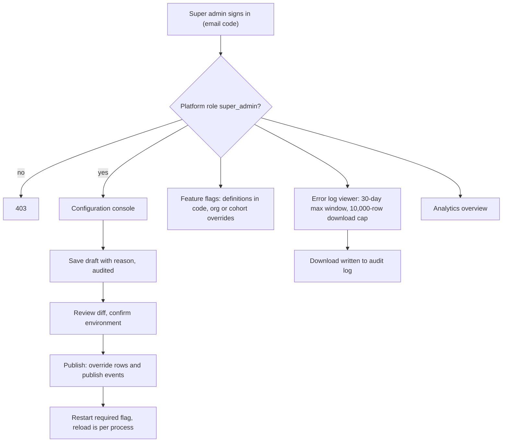

Errors reach the log viewer through `request_context`: each 5xx response and unhandled exception
writes one scrubbed `error_events` row. Rows older than 30 days are deleted once a day by the
`workers` process (`ERROR_EVENT_RETENTION_DAYS = 30`, `ops_service.prune_error_events`).

## 8. Background work and outbound webhooks

- `workers` runs three loops: the scheduler (section 6), the webhook outbox, and the daily prune.
- The webhook outbox (`backend/app/services/webhook_outbox.py`) polls every 5 seconds, claims up
  to 20 rows, and makes at most 5 attempts per row. The public API writes its outbox rows in the
  same database session as the change they describe (`backend/app/api/public_api/routes.py`).
- Only two webhook events are emitted by code in this repository: `conversation.created` and
  `message.created`, both from the public API (`backend/app/api/public_api/routes.py`). The event
  catalogue in `webhook_service.event_catalogue()` lists more (for example `workflow_finished`,
  `document_processed`, `lead_generated`, `widget.escalation`), but no code path emits them.
- Each delivery is signed with `X-OraOne-Signature: sha256=<HMAC-SHA256>`, with a delivery id and
  timestamp header (`backend/app/services/signed_webhook.py`).

## 9. Security boundaries

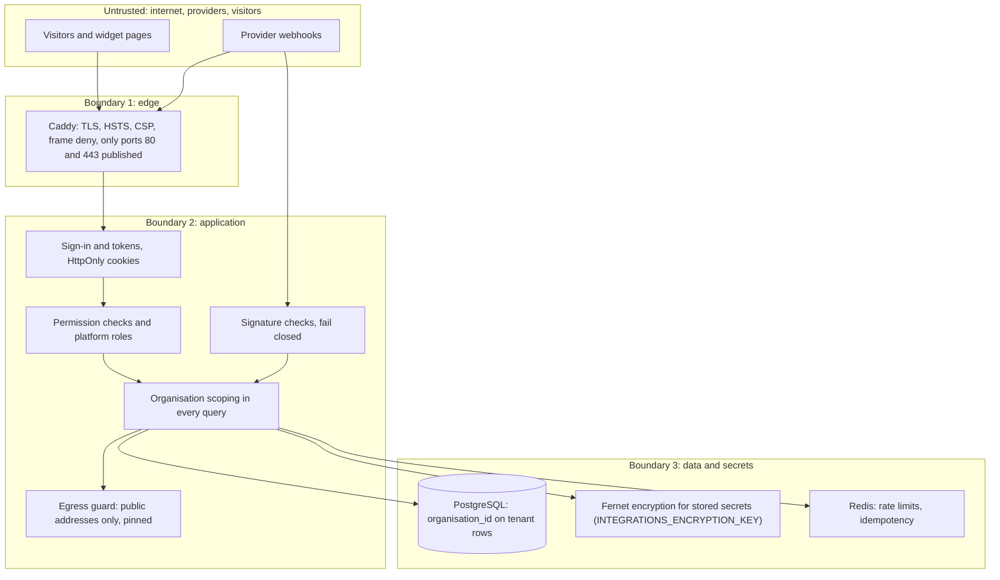

Controls verified in code:

- **Edge.** Caddy is the only published entry point. It sets HSTS, `X-Frame-Options: DENY`,
  `frame-ancestors 'none'`, a CSP, `nosniff` and a Permissions-Policy that disables camera,
  microphone and geolocation (`Caddyfile`). The CSP keeps `'unsafe-inline'` for scripts and styles
  (documented in the Caddyfile comment).
- **Sign-in.** Email code: a 6-digit code with a 10-minute lifetime, stored in the shared cache, with
  send and attempt limits (`auth_service`). The access token is a JWT. Refresh tokens are opaque random
  values tracked server-side (`core/security.py`). Both are set as HttpOnly cookies (`core/cookies.py`). `POST /api/auth/dev-login` is development-only and
  returns 404 unless explicitly enabled.
- **Authorisation.** Route dependencies `require_permission(...)` and `require_platform_role("super_admin")`.
- **Tenant isolation.** Application-level `organization_id` filters. Org context is stamped on the
  transaction (`set_config`). **PostgreSQL row-level security is not installed by any migration in
  this repository.** Treat tenant isolation as application code, backed by tests, until policies
  are added and verified.
- **Webhook authenticity.** Twilio, Meta, Telegram, SDK and email checks run before parsing, and
  comparisons are constant time. Missing config means reject.
- **Replay.** Provider message ids are recorded (`channel_inbound_receipts`). Mutating API calls
  accept an `Idempotency-Key`, backed by Redis (`middleware/idempotency.py`).
- **Outbound SSRF.** Customer webhook targets must resolve to public addresses, and redirects are
  disabled so each hop is checked (`services/webhook_service.py`). The crawler applies the same
  public-address rule (`services/website_crawler.py`). `services/egress_guard.py` provides pinned
  requests for this purpose.
- **Secrets.** Integration and channel secrets are stored as Fernet ciphertext with a short display
  hint (`core/crypto.py`, `services/channels/binding_secrets.py`). Responses show masked values.
  Channel change audit records carry field names, never values.
- **Proxy trust.** `TRUSTED_PROXY_IPS` names the Caddy address. Only that peer can set
  `X-Forwarded-For` for rate limiting (`docker-compose.prod.yml`).
- **Start-up checks.** In production-like environments the API refuses to start with missing or
  invalid required settings (`core/startup_checks.py`, which names the settings, not their values).
- **Logs.** Error records are scrubbed before storage and pruned after 30 days.

## 10. Not verified in this review

- No live request was made against the production stack. Health, TLS, and provider webhooks are
  unverified.
- Provider behaviour (Meta, Twilio, ElevenLabs, OpenRouter, SMTP, OAuth) is described from the
  calls in the code. No provider account was used.
- The scope guard, `assistant_profiles.py` and the `answer_query` changes are uncommitted at this
  commit. Re-check this section after they are committed.
- Frontend route and component names were spot-checked, not traced in full.
