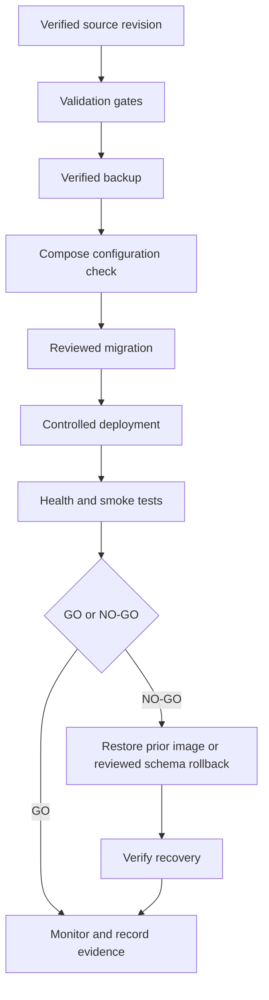

# Backup and restore

Production backup evidence is an external release gate.

1. Identify the intended database host and name using a read-only check.
2. Create an encrypted pg_dump outside the application checkout.
3. Restore into a disposable PostgreSQL instance.
4. Run backend/scripts/backup_restore_drill.py against the disposable restore.
5. Verify Alembic revision, critical row counts, Cognito mappings, and vector extension.
6. Record timestamp, encryption location, restore duration, and operator.
7. Document retention and ownership.

Do not run alembic upgrade head against production until backup and target identity are independently verified. This checkout contains tooling and instructions, not a production backup result.

## Release and recovery workflow

<!-- diagram: docs/diagrams/release-recovery.mmd -->

