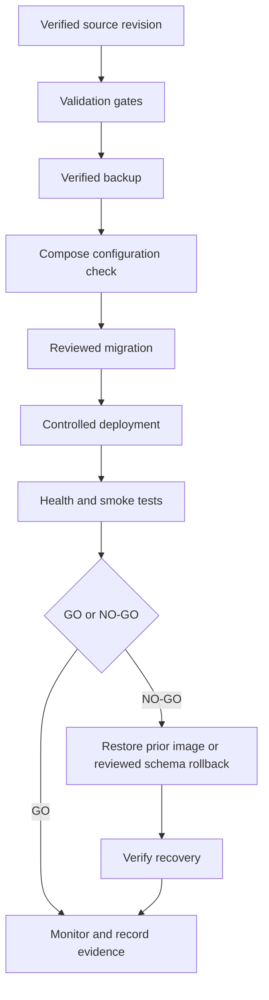

# Backup and restore

Production backup evidence is an external release gate.

## Weekly production backup plan

Run `backend/scripts/weekly_backup.py` from a locked-down weekly systemd timer
or cron job on the VPS. Set `DB_NAME`, `DB_PASSWORD`,
`ORAONE_BACKUP_DIR` to a directory outside `/srv/apps/oraone`, and
`ORAONE_BACKUP_PASSPHRASE_FILE` to a root-readable file outside the checkout.
The script creates a `pg_dump` custom-format backup encrypted with GPG AES-256
and mode `0600`. Keep at least four weekly copies on separate encrypted
storage, and monitor the job for failures.

Weekly backup is not a replica: a replica improves recovery time but does not
replace independent backups. Add a managed PostgreSQL replica only after its
cost, retention, failover, and provider support are approved.

Example scheduler command:

```text
DB_NAME=oraone DB_PASSWORD='set-outside-git' \
ORAONE_BACKUP_DIR=/var/backups/oraone \
ORAONE_BACKUP_PASSPHRASE_FILE=/etc/oraone/backup.pass \
python3 /srv/apps/oraone/backend/scripts/weekly_backup.py
```

After each backup, restore one copy into a disposable PostgreSQL instance and
run `backend/scripts/backup_restore_drill.py`. Never store the passphrase in
GitHub Actions logs, the repository, or the application `.env` file.

1. Identify the intended database host and name using a read-only check.
2. Create an encrypted pg_dump outside the application checkout.
3. Restore into a disposable PostgreSQL instance.
4. Run backend/scripts/backup_restore_drill.py against the disposable restore.
5. Verify Alembic revision, critical row counts, email-code mappings, and vector extension.
6. Record timestamp, encryption location, restore duration, and operator.
7. Document retention and ownership.

Do not run alembic upgrade head against production until backup and target identity are independently verified. This checkout contains tooling and instructions, not a production backup result.

## Release and recovery workflow

<!-- diagram: docs/diagrams/release-recovery.mmd -->


