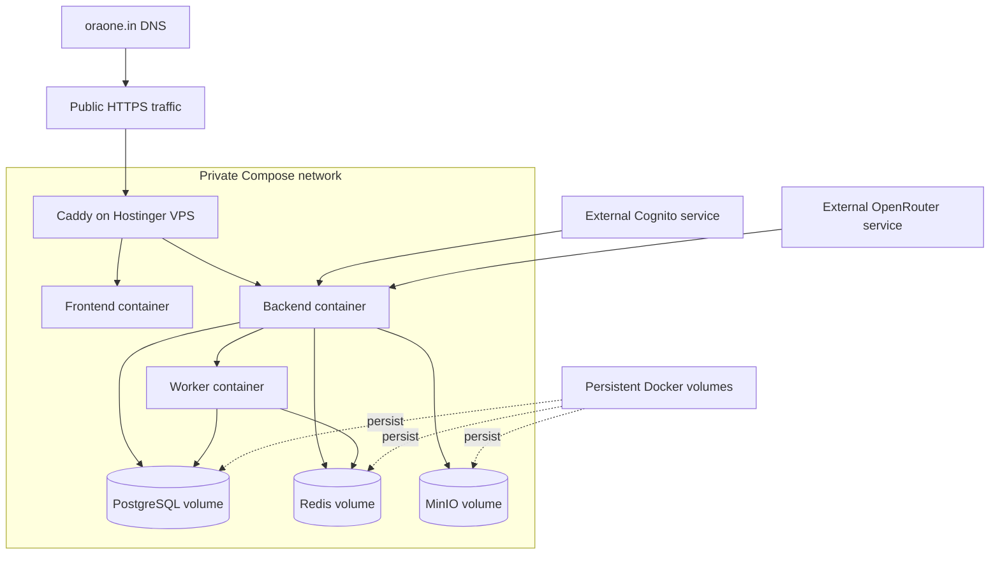

# Deployment

This describes the production-like Compose artifact. It does not claim Hostinger, DNS, TLS, or Cognito live traffic is configured.

1. Provision an approved host and firewall with only SSH and 80/443 exposed.
2. Clone the intended repository and record the Git SHA.
3. Supply operator-managed .env.production and backend/.env; never commit them.
4. Run docker compose --env-file .env.production -f docker-compose.prod.yml config.
5. Review missing interpolation, public ports, and provider settings.
6. Back up the target database before migrations.
7. Verify database identity before applying migrations.
8. Start the stack and check health.
9. Run auth, tenant-isolation, widget, webhook, billing, and AI smoke tests.

Caddy terminates TLS and routes /api/* to FastAPI. Other services remain private.

Keep previous image tags and Git SHA. Roll back by redeploying the previous image while preserving a compatible schema. Reverse migrations only with a reviewed down migration and verified backup.

## Hostinger deployment

<!-- diagram: docs/diagrams/deployment.mmd -->

